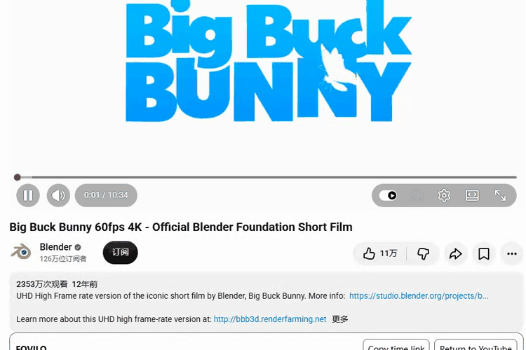

# FOVILO

[English](README.md)

FOVILO 是面向桌面 YouTube 的实验性 Chromium 扩展。首个播放页控件可以复制当前时间链接。点击 **Return to YouTube** 会移除控件并保存全局关闭状态。扩展弹窗可重新启用，也可单独关闭播放页控件。

Everyday 在 YouTube 原生播放页上区分视频标题、频道和元数据的视觉层级，控件跟随 YouTube 的浅色或深色主题。

查看[启用与恢复对照](docs/RELEASE_MATERIALS.md#watch-development-preview)及录制环境。影片片段 © 2008 Blender Foundation，[CC BY 3.0](https://peach.blender.org/about/)。

## 试用开发版

1. 在 `dev` 工作树用 Node.js 24 运行 `npm ci` 和 `npm run build`。
2. 打开 `chrome://extensions`，启用开发者模式，选择 **加载已解压的扩展程序**，选中生成的 `dist` 文件夹。
3. 刷新已打开的桌面 YouTube 标签页，再进入普通视频。识别到兼容布局时，控件显示在播放器下方。

扩展只在本地保存两项设置，内容脚本运行于 `https://www.youtube.com/*`。复制链接由用户主动触发。构建产物无遥测或扩展后端服务。

浏览器拒绝访问剪贴板时，FOVILO 会显示可选中的链接。关闭播放页控件时，如果键盘焦点仍在 FOVILO 内，焦点会回到 YouTube 原生视频标题。

## 开发

运行 `npm run typecheck`、`npm run lint`（Manifest 策略检查）和 `npm test`。浏览器夹具测试需先运行 `npx playwright-core install chromium --no-shell`，再运行 `npm run test:browser`。参见[验证矩阵](docs/QA_MATRIX.md)和[宣发物料计划](docs/RELEASE_MATERIALS.md)。

测试浏览器能访问 YouTube 时，可单独运行 `npm run test:live`。该测试使用全新的无登录配置和 Blender 的公开视频。

启动性能和时间链接反馈的测量方法见[性能基线](docs/PERFORMANCE_BASELINE.md)。

FOVILO 是项目暂定名。本项目独立于 YouTube 和 Google。
