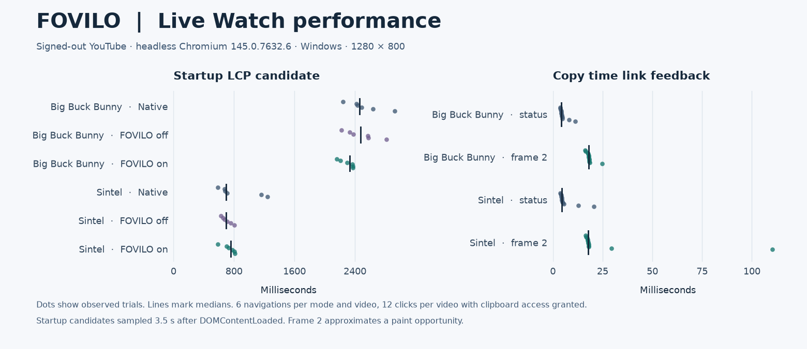

# Watch performance baseline

Run `npm run perf` for a fixed Watch fixture. The only response is a small synthetic HTML page served at the same origin and path as the real Watch page. Run `npm run perf -- --live` for the signed-out public YouTube video. Both use Playwright Chromium and the actual built MV3 package.

Each run creates fresh profiles for native Chromium, FOVILO installed and disabled through its popup, and FOVILO enabled. It warms each profile with one navigation, then opens the same URL six times per state by default. Use `--rounds=9` after the npm argument separator for nine rounds. State order rotates between rounds. Each sampled tab returns to `about:blank` before the next profile is sampled, stopping the previous page's playback and background work. Each navigation has checkpoints about 1.5 and 3.5 seconds after DOMContentLoaded. The test checks page visibility and expects one control only when FOVILO is on. A partial run is labeled incomplete.

Raw samples, browser and OS versions, viewport and build hashes are written to `work/perf-fixture/samples.json` and `work/perf-live/samples.json`. Each checkpoint reports navigation-to-DOMContentLoaded, LCP candidate history with element type and page region where available, shifts without recent user input, and long task counts. CDP renderer duration deltas cover the longer post-DOMContentLoaded window. Treat the shift sum as a windowed diagnostic. Interpret task timings as combined renderer work and omit invalid deltas. The sample does not identify individual extension tasks. [Largest Contentful Paint specification](https://w3c.github.io/largest-contentful-paint/)

Add `--trace` to capture one extra navigation per state after the timed samples. The resulting `trace-native.json`, `trace-off.json` and `trace-on.json` files can be opened in Chromium DevTools. The traced navigations are excluded from summary statistics. The raw trace files stay in the ignored local work directory. [Chrome DevTools Protocol Tracing](https://chromedevtools.github.io/devtools-protocol/tot/Tracing/)

Use `--video=<id>` to measure another public Watch page and store its report under the corresponding video ID subdirectory. On live runs, `--interactions` adds 12 trusted Playwright clicks on **Copy time link** after startup sampling. It checks the success message and compares the clipboard link to the media time read during that click. The test browser grants clipboard access for this run. Each sample records elapsed time from the click event to the status mutation and to the second animation-frame callback after that mutation. The second value approximates a paint opportunity. This test measures repeated clicks on a single mounted page and requests a pause before clicking.

Use `npm run perf -- --live --rounds=0 --video=<id> --interactions --trace` for a focused follow-up. It writes under the video's `interactions/` directory so the startup report is preserved. It records one batch without tracing and another with tracing, both in the same isolated profile on separate page loads. The `trace-copy.json` timeline marks input, event dispatch, status mutation, and both frame callbacks for each traced click. The JSON report also lists long tasks overlapping each measured interval. Dispatch-to-status includes clipboard work, scheduling and DOM mutation delivery. It cannot isolate clipboard service time on its own.

This baseline covers startup and one Watch interaction in headless Chromium. Final Core Web Vitals, INP, keyboard and mobile interaction latency, background behavior, real-device traces and high-refresh performance still need dedicated runs. Use the raw samples to check variation before interpreting differences between modes. The fixture only checks that instrumentation and extension states work under repeatable conditions.

## 2026-11-12 first baseline

Windows, Intel Core i7-13650HX, Chrome for Testing 145.0.7632.6, 1280×800, six samples per state. The unminified content script was 9,365 bytes. For the fixture, the median LCP candidates were 22 ms native, 24 ms off and 22 ms on. Each fixture sample reported zero long tasks.

The first live probe used reloads while other test profiles could still be playing YouTube. Part of that run overlapped a fixture run. It prompted the switch to blanking profiles between samples and running the fixture and live measurements sequentially. The original raw probe is retained locally as `work/perf-live/overlap.json`.

The sequential live run yielded the following medians and observed ranges in milliseconds.

| State | DOMContentLoaded | LCP candidate | Renderer task duration after DOMContentLoaded |
| --- | ---: | ---: | ---: |
| Native | 1,248 (1,016–1,995) | 1,580 (1,472–3,480) | 1,107 (1,069–1,318) |
| FOVILO off | 1,250 (1,107–2,021) | 1,572 (1,452–3,532) | 1,095 (1,053–1,290) |
| FOVILO on | 1,219 (1,134–1,996) | 2,144 (1,428–3,424) | 1,097 (1,032–1,166) |

The enabled median LCP candidate was 564 ms above native in this run. The ranges overlap and the measured renderer task medians were close. The startup performance gate stays open. The raw samples for this first baseline were retained locally as `startup-baseline.json` in each report directory.

## 2026-11-12 candidate and trace follow-up

Ran `npm run perf -- --rounds=2 --trace` for the fixed fixture and `npm run perf -- --live --rounds=9 --trace` for the same signed-out YouTube video. Both runs completed. The fixture identified its native heading at both checkpoints in every sample. The live run recorded nine samples per state with the same browser and viewport as the first baseline.

| State | LCP candidate at DCL + 1.5 s, median (range) | LCP candidate at DCL + 3.5 s, median (range) |
| --- | ---: | ---: |
| Native | 2,516 ms (1,528–2,604) | 2,556 ms (2,448–3,780) |
| FOVILO off | 2,556 ms (1,456–2,624) | 2,560 ms (2,436–3,544) |
| FOVILO on | 2,548 ms (1,360–2,768) | 2,624 ms (2,464–3,728) |

All 27 live samples ended on a candidate associated with a `div` inside YouTube's player. None of the recorded candidate entries were associated with a FOVILO element. The candidate timestamp changed between checkpoints in seven samples, two native, two off and three on. At the short checkpoint, the enabled median was 32 ms above native, compared with 564 ms in the initial run. At the longer checkpoint, it was 68 ms above native. This follow-up did not reproduce the magnitude of the initial gap. The single-video headless runs cannot establish causality or final LCP.

Each state produced a separate DevTools timeline with three LCP candidate events. The enabled trace contained 137 `EvaluateScript` or `FunctionCall` events whose source URL ended in FOVILO's `content.js`. Their recorded durations summed to 5.6 ms. This is a source-tagged event sum from one trace. It can include nested events and omits work without that source label. Use the local traces to investigate attribution, then measure interactions and additional videos before setting a release threshold.

## 2026-11-12 second video and click feedback

Ran `npm run perf -- --live --rounds=3 --video=<id> --interactions` for `aqz-KE-bpKQ` (*Big Buck Bunny*) and `eRsGyueVLvQ` (*Sintel*). The two runs completed 18 startup samples and 24 successful clipboard checks. Reports are in `work/perf-live/<id>/samples.json`.

| Video | LCP candidate median at DCL + 3.5 s, native / off / on | Click to status change, median (range) | Click to second animation-frame callback, median (range) |
| --- | ---: | ---: | ---: |
| Big Buck Bunny | 2,864 / 2,856 / 2,904 ms | 7.4 ms (5.9–13.8) | 16.2 ms (15.1–23.4) |
| Sintel | 532 / 688 / 436 ms | 11.8 ms (7.5–156.2) | 23.4 ms (15.7–259.5) |

In these samples, the latest LCP candidate was a player-region `div` for *Big Buck Bunny* and a `div` outside the tracked player and metadata regions for *Sintel*. There were three startup observations per state and 12 clicks on one page instance per video. The test browser had clipboard access pre-granted. One *Sintel* click took 156.2 ms to update the status and 259.5 ms to reach the second frame callback. A dedicated interaction trace is needed to distinguish input scheduling, clipboard completion and frame scheduling. Treat the frame timing as an approximation and keep the interaction performance gate open.

## 2026-11-12 copy interaction traces

Ran the focused command on both videos. All 48 clicks passed clipboard verification, split into 12 untraced and 12 traced clicks per video. Each trace contains all 60 expected phase marks. Local reports and traces are in `work/perf-live/<id>/interactions/`.

| Video | Click to second frame callback, untraced median / maximum | Traced median / maximum |
| --- | ---: | ---: |
| Big Buck Bunny | 18.6 / 179.6 ms | 16.8 / 30.1 ms |
| Sintel | 22.1 / 275.7 ms | 22.1 / 190.3 ms |

The slowest traced *Sintel* click took 71.5 ms to dispatch, another 54.7 ms to update status, 28.9 ms to the first frame callback and 35.2 ms to the second. Long Tasks reported 63 ms and 50 ms tasks overlapping the interaction. In that trace interval, the renderer main thread had YouTube-tagged function calls inside animation-frame callbacks. The longest YouTube-tagged function call was 27.4 ms. The longest extension-tagged function call was 1.0 ms. These are source-tagged events in one interval and can be nested.

The slow tail recurred without tracing on both videos. Scheduling delays are present before and after dispatch. The trace did not expose a distinct clipboard service event, so it cannot attribute the entire dispatch-to-status interval. The untraced and traced sets are separate observations. Keep the interaction gate open for additional devices, ordinary clipboard permissions and input modalities.

## Development build preview



These runs used commit `9bffcb2` on Windows with an Intel Core i7-13650HX and headless Chrome for Testing 145.0.7632.6 at 1280 × 800. Each signed-out video had six navigations per state and 12 untraced clicks in one enabled page with clipboard access granted. The reports record the environment, manifest and content script hashes, both startup checkpoints and every click. [Big Buck Bunny samples](evidence/watch-9bffcb2/big-buck-bunny.json) · [Sintel samples](evidence/watch-9bffcb2/sintel.json)

| Video | Startup candidate median, native / off / on | Click to status, median / maximum | Click to second frame, median / maximum |
| --- | ---: | ---: | ---: |
| Big Buck Bunny | 2,462 / 2,472 / 2,330 ms | 4.4 / 11.3 ms | 18.1 / 24.7 ms |
| Sintel | 696 / 694 / 756 ms | 4.5 / 20.6 ms | 17.7 / 110.2 ms |

With FOVILO enabled, the candidate median was 132 ms earlier than native on *Big Buck Bunny* and 60 ms later on *Sintel*. These are windowed observations from two URLs on one machine. The second frame callback approximates a paint opportunity. The performance gate remains open for additional devices, ordinary clipboard permissions and keyboard interactions.

To regenerate the figure from the retained reports with Python and Matplotlib 3.11.0, run this from the repository root.

```sh
python scripts/plot_watch_performance.py docs/evidence/watch-9bffcb2/big-buck-bunny.json docs/evidence/watch-9bffcb2/sintel.json docs/media/watch-performance.png
```
