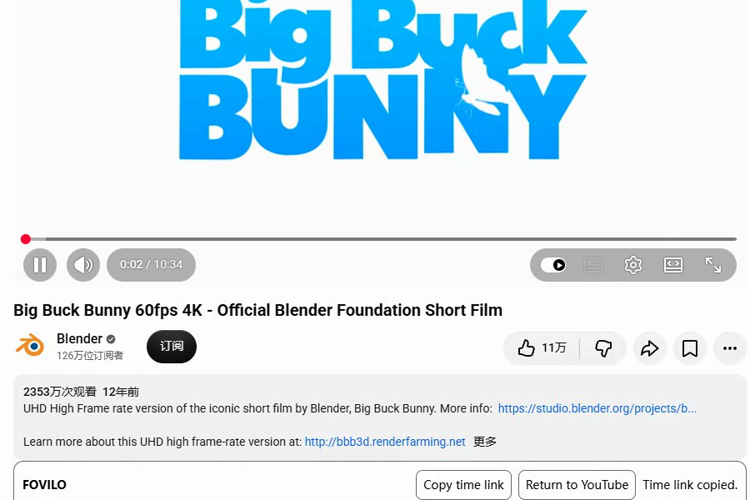
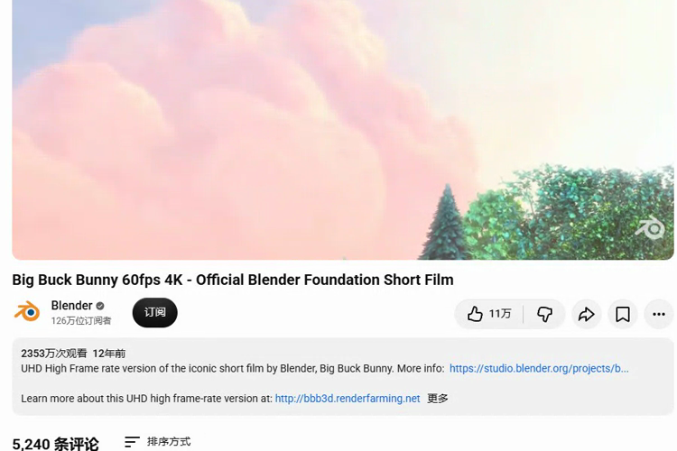

# GitHub release materials

The English README is the entry point. Link the Chinese version from the top. At release, put installation and one same-viewport before/after pair near the top. Group additional Watch, popup, themes and future page captures by supported feature. [MARGIN preview](https://github.com/jiuyang5354/bilibili-margin#界面预览) · [Kempt README](https://github.com/remonilo/kempt-yt)

Use side-by-side comparisons for visual changes and direct download links for the verified Chromium package. Keep a versioned ZIP, SHA-256 checksum and changelog with the release. [DeArrow](https://dearrow.ajay.app/) · [SponsorBlock](https://github.com/ajayyy/SponsorBlock) · [Astra Deck](https://github.com/SysAdminDoc/Astra-Deck)

The development materials include a short looping README preview and an MP4 walkthrough. Use footage and thumbnails with permission, omit private account information, and retain capture provenance. Store screenshots and recordings outside the extension ZIP.

The development ZIP and checksum can be generated with the [release runbook](RELEASE_RUNBOOK.md). The [Watch performance chart](PERFORMANCE_BASELINE.md#development-build-preview) includes observed startup and copy feedback samples. The [store listing draft](STORE_LISTING.md) includes bilingual copy, localized screenshots and an icon candidate. Final store assets and public release links are pending.

## Watch development preview

| Time link copied | After Return to YouTube |
| --- | --- |
|  |  |

The [looping preview](media/watch-demo.gif) and both stills were cropped from the same signed-out live YouTube session on 2026-11-12. Chrome for Testing 145.0.7632.6 on Windows, 1280×800 viewport, development build 0.0.1. The crop excludes recommendations. The recording is muted.

The [18-second MP4 walkthrough](media/watch-walkthrough.mp4) is a continuous capture from a second signed-out live session on 2026-11-12 with the same browser, a 1280×900 viewport and development commit `9bffcb2`. It shows **Copy time link**, **Cinema**, **Everyday**, and **Return to YouTube** in order. Playback continued from 1.10 s to 19.64 s during the observed sequence. The export trims startup, crops the recommendations and adds a title and attribution strip. It has no audio track.

The film is *Big Buck Bunny*, © 2008 Blender Foundation / www.bigbuckbunny.org. The preview uses a cropped excerpt. [Film on YouTube](https://www.youtube.com/watch?v=aqz-KE-bpKQ) · [CC BY 3.0 attribution terms](https://peach.blender.org/about/)
